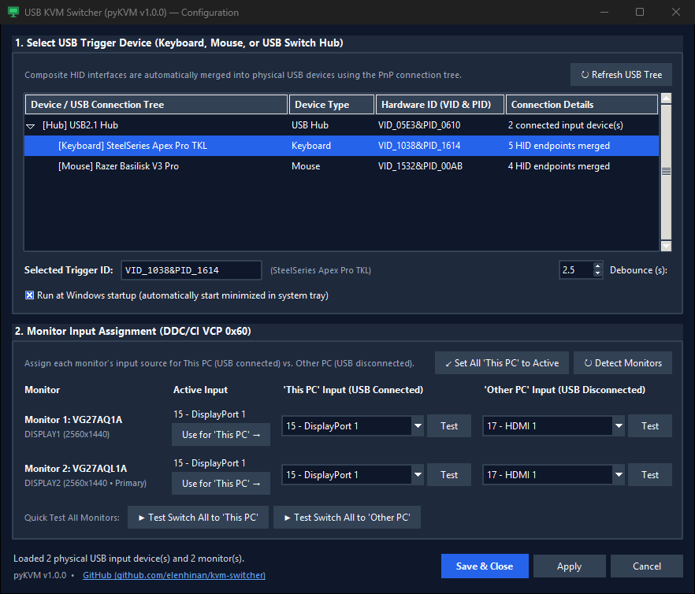

# pyKVM — USB Display / KVM Switcher for Windows

**pyKVM** is a lightweight Windows system tray utility that turns an inexpensive USB switch into a full multi-monitor KVM switch. When your USB keyboard, mouse, or USB switch hub connects or disconnects, **pyKVM** automatically switches all of your monitors between **This PC** and **Other PC** using DDC/CI (`VCP 0x60`).



---

## Typical Use Case Scenario

Hardware multi-monitor KVM switches that support high resolutions, high refresh rates (144Hz+), and G-Sync/FreeSync are expensive and often introduce EDID or signal-drop quirks. Instead, you can keep your video cables connected directly to your monitors and use a cheap (\$15–\$25) USB 3.0 switch for your peripherals:

1. **Peripherals on a Cheap USB Switch**:
   - Plug your keyboard, mouse, webcam, headset/DAC, etc. into an inexpensive 2-port USB switch.
   - Connect USB Output 1 to your **Desktop PC** and USB Output 2 to your **Laptop Dock**.
2. **Direct Video Connections**:
   - **Desktop PC** connects directly to your monitors via **DisplayPort** (`15 - DisplayPort 1`) for full native refresh rate, HDR, and VRR/G-Sync.
   - **Laptop Dock** connects directly to the same monitors via **HDMI** (`17 - HDMI 1`).
3. **One-Button Switching with pyKVM**:
   - Run **pyKVM** on your Desktop PC (configured to watch your keyboard, mouse, or the USB switch's internal hub).
   - When you press the button on the USB switch to move your keyboard and mouse over to the **Laptop Dock**, **pyKVM** detects the USB disconnect event and automatically switches both monitors to **HDMI 1** (`Other PC`).
   - When you press the USB switch button to switch back to your **Desktop PC**, **pyKVM** detects the USB reconnect event and switches your monitors right back to **DisplayPort 1** (`This PC`).

---

## Features

- **Smart USB Connection Tree Discovery**:
  - Scans the Windows PnP device tree (`CfgMgr32`) and automatically merges composite HID endpoints (`MI_00`, `MI_01`, `COL01`, etc.) so gaming keyboards and mice appear as single physical devices instead of dozens of generic HID entries.
  - Groups peripherals under their parent external USB hub so you can trigger switching from a specific keyboard, mouse, or the USB switch's internal hub itself.
- **Easy Per-Monitor Input Configuration**:
  - Automatically detects connected monitors with their EDID model names, display identifiers, resolutions, and primary status.
  - Reads each monitor's **Current Active Input** via DDC/CI (`VCP 0x60`) and lets you assign it to **This PC** with one click.
  - Includes per-monitor and global **Test** buttons to verify input switching immediately.
  - Saves monitor input mappings by EDID hardware ID (`monitor_map`) in `config.json` so assignments stay pinned to the right physical monitor even if Windows reorders display indices.
- **System Tray & Windows Startup Integration**:
  - Runs silently in the Windows system tray with quick manual switch actions and an **Auto-Switch Enabled** toggle.
  - Built-in **Run at Windows startup** option (in both the GUI and tray menu) that launches directly into the system tray (`--tray`) without popping up the configuration window.

---

## Getting Started

### Option 1: Download Pre-Built Executable (Recommended)

Download `pyKVM.exe` directly from the [**GitHub Releases**](https://github.com/elenhinan/kvm-switcher/releases/latest) page and run it. On first launch, the Configuration window will open automatically and save your settings to `config.json` in the same folder.

### Option 2: Run from Python Source

1. Clone this repository:
   ```powershell
   git clone https://github.com/elenhinan/kvm-switcher.git
   cd kvm-switcher
   ```
2. Create a virtual environment and install dependencies:
   ```powershell
   python -m venv .venv
   .\.venv\Scripts\pip install -r requirements.txt
   ```
3. Launch the application:
   ```powershell
   .\.venv\Scripts\pythonw.exe pyKVM.pyw
   ```

### Option 3: Build a Standalone `.exe` Locally

Run the included batch script (or `build_exe.py`) to build a standalone windowless executable in `dist\pyKVM.exe`:

```powershell
.\build_exe.bat
```

---

## Command-Line Arguments

| Argument | Description |
| :--- | :--- |
| *(none)* | Starts in the system tray if already configured (`config.json`), or opens the Configuration window on first run. |
| `--config` | Opens the Configuration window on startup even if already configured. |
| `--tray` | Forces silent startup directly into the system tray without opening the Configuration window (used by Windows Startup). |

---

## Requirements

- Windows 10 / 11
- Monitors with **DDC/CI** enabled in their On-Screen Display (OSD) settings
- Python 3.10+ (only required when running from source)

---

## License

Released under the [MIT License](LICENSE).
